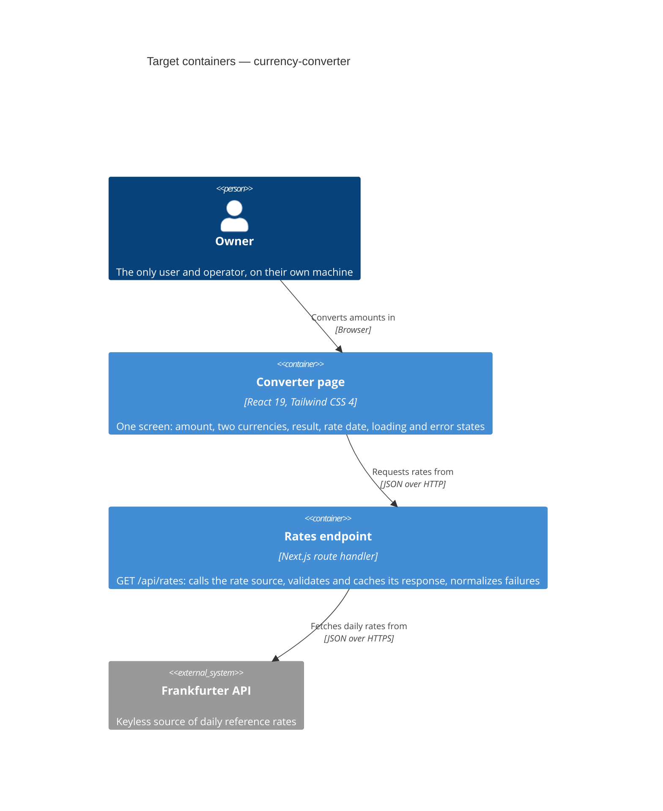

# Architecture map — currency-converter

> The **target foundation** of a repo with no source yet, produced by `survey`'s greenfield session
> and read by specify / design / data-model / implement. Nothing below exists until `/sdd:scaffold`
> materializes it; paths are the target layout. The "why" of each irreversible pick lives in
> `docs/adr/`.

## Stack

- Language / runtime: TypeScript 6.0 in `strict` mode on Node 22 — [ADR-0001](./adr/0001-next-js-full-stack-typescript.md)
- Frameworks: Next.js 16 (App Router), React 19, Tailwind CSS 4
- Libraries: `big.js` (decimal arithmetic), `zod` (runtime validation of the rate source's responses)
- Package manager: npm
- Build / test / lint: `npm run build`, `npm test` (Vitest), `npm run lint` (ESLint 9), `npm run typecheck` (`tsc --noEmit`), Prettier for formatting
- Version pins: TypeScript stays on 6.0 and ESLint on 9 — see Constraints

## C4 — system as it is

Target baseline; the system does not exist yet.

## Module inventory

Target layout, one Next.js project. Dependencies point inward: `app` and `ui` and `server` may import `domain`; `domain` imports nothing from the others.

| Module | Path | Layers | Wired at | Responsibility |
|---|---|---|---|---|
| app | `src/app/` | routing | `src/app/page.tsx`, `src/app/api/rates/route.ts` | Next.js entry points; composes `ui` and `server`, holds no business logic |
| domain | `src/domain/` | domain | imported directly | Pure money logic and shared types: parsing, conversion, rounding. No React, no Next.js, no I/O |
| server | `src/server/` | infra | `src/app/api/rates/route.ts` | Frankfurter client: the request, response validation, mapping failures to error codes. Never imported by client components |
| ui | `src/ui/` | presentation | `src/app/page.tsx` | React components and their state |

## Conventions (cited — the rules a new feature must match)

Each cites the ADR that fixes it; target code examples arrive with `/sdd:scaffold`.

- **Module wiring / registration:** no container; plain imports following the dependency rule above, with the `@/` alias for `src/` — [ADR-0002](./adr/0002-layered-src-modules.md)
- **Error handling:** the route handler always answers failures as `{ "error": { "code", "message" } }` with a matching HTTP status; `code` is a stable machine value the UI maps to its error state; raw upstream errors never reach the browser — [ADR-0001](./adr/0001-next-js-full-stack-typescript.md)
- **Money:** amounts and rates are `big.js` values inside `domain`, never JavaScript `number` arithmetic — [ADR-0002](./adr/0002-layered-src-modules.md)
- **External input:** anything from the network is parsed with `zod` at the `server` boundary before use — [ADR-0001](./adr/0001-next-js-full-stack-typescript.md)
- **IDs:** none; the app has no entities — [ADR-0003](./adr/0003-no-persistent-datastore.md)
- **Persistence / DB access:** none; the only server-side state is the Next.js `fetch` cache — [ADR-0003](./adr/0003-no-persistent-datastore.md)
- **Migrations:** none, no datastore — [ADR-0003](./adr/0003-no-persistent-datastore.md)
- **Tests:** Vitest, with Testing Library + jsdom for components and `msw` to fake the rate source; a test sits next to its source as `*.test.ts(x)`; tests never call the real API — [ADR-0001](./adr/0001-next-js-full-stack-typescript.md)
- **Inter-module communication:** direct imports in-process; the browser reaches the server only through `/api/rates` — [ADR-0002](./adr/0002-layered-src-modules.md)
- **UI / styling (if a frontend exists):** Tailwind CSS 4 utility classes; no second styling approach — [ADR-0001](./adr/0001-next-js-full-stack-typescript.md) (detail in §Frontend / UI foundation below)
- **CI:** one GitHub Actions workflow runs build, test, lint and typecheck — [ADR-0001](./adr/0001-next-js-full-stack-typescript.md)

## Datastores

| Store | Engine | Accessed via | Notes |
|---|---|---|---|
| none | — | — | [ADR-0003](./adr/0003-no-persistent-datastore.md). Rate responses live only in the Next.js `fetch` cache, which can be discarded at any time |

## Frontend / UI foundation

Target; no component exists yet and no design system has been chosen. `/sdd:design-system` is the place to fix tokens and the component inventory.

- **Component library / design system:** none yet; in-repo components in `src/ui/`
- **Design tokens:** Tailwind CSS 4 theme in `src/app/globals.css` (target)
- **Styling approach:** Tailwind CSS 4 utility classes — [ADR-0001](./adr/0001-next-js-full-stack-typescript.md)
- **Shared primitives:** none yet; add to `src/ui/` when a second use appears
- **State / data-fetching:** React state and `fetch` to `/api/rates` from a client component; no store or server-cache library, one screen does not need them
- **Closest UI precedent:** none yet; the converter screen becomes the first

## Where things live / closest precedents

No precedents exist yet; the first feature sets them.

- Money calculation → `src/domain/`, covered by unit tests with no mocks.
- A call to an external service → a client in `src/server/`, exposed to the browser through a route handler in `src/app/api/`.
- A new screen / UI component → `src/ui/`, composed in a page under `src/app/`.

## Constraints & known tech-debt

- **TypeScript pinned to 6.0 (`~6.0`).** `typescript-eslint` 8.72, which `eslint-config-next` 16.4 depends on, supports TypeScript `<6.1.0`, while npm's latest is 7.0. Lift the pin when `typescript-eslint` supports 7 (checked 2026-10-30).
- **ESLint pinned to 9.** `eslint-plugin-react`, `eslint-plugin-import` and `eslint-plugin-jsx-a11y`, all pulled in by `eslint-config-next`, declare peer support only up to ESLint 9, while npm's latest is 10 (checked 2026-10-30).
- **`next lint` does not exist in Next.js 16.** `npm run lint` calls the ESLint CLI with a flat `eslint.config.mjs`.
- **Next.js `fetch` is uncached by default.** The rates request must set `next: { revalidate }` itself, or every page load reaches Frankfurter. The interval is decided in the feature's design.
- **Frankfurter's v2 endpoint is required for UAH.** `GET https://api.frankfurter.dev/v2/rates` returned UAH on 2026-10-30; the v1 `latest` endpoint did not (`docs/idea-brief.md` §6). Frankfurter remains a proposal until specify or design confirms it; alternatives are in the same ledger.
- **Single upstream source.** If it is down and nothing is cached, conversion cannot refresh (`docs/idea-brief.md` §6, risk 3). Behaviour in that case is an open question for specify.
- **Local only.** The app needs a running Node process (`npm run dev`, or `npm run build` then `npm start`); public deployment is out of scope.

## Reconciliation with the authored architecture doc

No authored architecture doc; this map is the current reference. `docs/idea-brief.md` is the intent input and one point differs: it describes a browser client calling the rate source directly with no server in between, while this foundation puts a route handler in between, at the owner's request. It still meets the brief's exclusion of a *separate* backend. The brief was left unedited; [ADR-0001](./adr/0001-next-js-full-stack-typescript.md) records the change.
