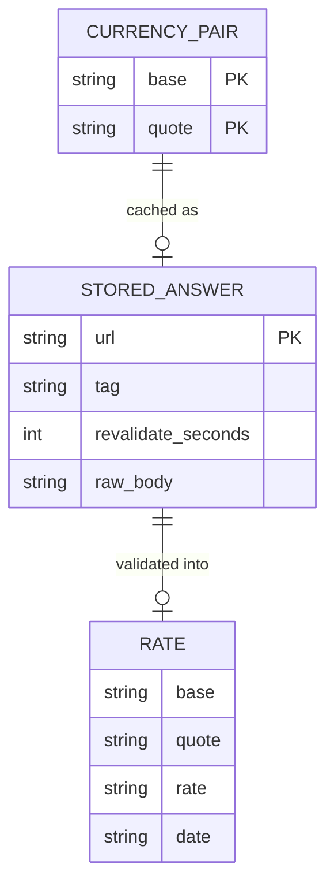

# Data model — converter

**This feature changes no schema.** The app has no datastore, tables or migrations (repo ADR-0003), and no flow in `sad.md` §6 adds an application entity, column or index. This document therefore records the data shapes the feature uses, so `api` and `implement` work from one description. Nothing here is a table: "Column" below means a field of a shape, and types are TypeScript types.

Nothing was staged under `migrations/`, and `implement` has nothing to promote.

## ER diagram

A logical view of the shapes. Only `STORED_ANSWER` outlives a request, and the framework owns it.

## Entities

### `currency_pair`

| Column | Type | Constraints | Notes |
|---|---|---|---|
| `base` | `Currency` | One of UAH, USD, EUR, GBP, PLN | The source currency in `CONTEXT.md` |
| `quote` | `Currency` | One of UAH, USD, EUR, GBP, PLN; differs from `base` | The target currency in `CONTEXT.md` |

**Aggregate root:** root. The list of supported currencies and the swap rule live in `src/domain/currency.ts`.
**Access patterns:** held in `ui` state, starting as USD to UAH (AC-07). The route refuses an unsupported or identical pair before calling the rate source (flow 8).
**Constraints:** order matters, so USD to UAH and UAH to USD are two pairs (AC-09). A pair never holds one currency twice (AC-08).

### `stored_answer`

The framework owns this entry under `.next/cache`. The app only sets the request options and asks for an entry to be dropped (ADR-0004).

| Column | Type | Constraints | Notes |
|---|---|---|---|
| `url` | `string` | Names exactly one pair | `v2/rates?base=USD&quotes=UAH`, so each pair has its own entry, at most 20 in all (ADR-0003) |
| `tag` | `string` | One per pair | Lets the route drop this entry with `revalidateTag(tag, { expire: 0 })` |
| `revalidate_seconds` | `number` | 3600, and at most 24 hours (spec §6) | Set as `next: { revalidate }` on the request |
| `raw_body` | `string` | Untrusted until validated | Observed form: `[{"date":"2026-10-31","base":"USD","quote":"UAH","rate":45.436}]`. Any answer with status 200 is stored, whatever its body holds |

**Aggregate root:** `currency_pair`. Each pair has at most one entry.
**Access patterns:** read by request URL inside the framework (flows 3, 5 and 7). The app runs no query of its own.
**Constraints:** a rate past its refresh interval stays usable (AC-12). An answer that fails validation is dropped at once. Deleting the cache loses nothing except stored rates (repo ADR-0003).

### `rate`

The rate as `server` answers it and `ui` holds it. It is built for each reply and never written anywhere by the app.

| Column | Type | Constraints | Notes |
|---|---|---|---|
| `base` | `Currency` | Equals the requested `base` | Another pair makes the answer untrusted (AC-12) |
| `quote` | `Currency` | Equals the requested `quote` | Another pair makes the answer untrusted (AC-12) |
| `rate` | `string` | Plain positive decimal, such as `45.436`, with no exponent form | Never a `number` in the browser (ADR-0006). `domain` builds the `big.js` value and the displayed digits from it |
| `date` | `string` | A real calendar date as `YYYY-MM-DD`; its age never makes it invalid | Stays a string and never becomes a `Date`, so no time zone can shift it (AC-06) |

**Aggregate root:** `currency_pair`. `useRate(pair)` keeps each rate together with its pair (AC-13, AC-13b).
**Access patterns:** the type lives in `src/domain/rate.ts`. `zod` parses the source's answer in `src/server/rate-source.ts` and the route's reply in `src/ui/rates-api.ts`.
**Constraints:** the source's `date`, `base` and `quote` pass through unchanged, and only `rate` changes form, from number to string. The field names follow the source's, and `api` fixes them in the contract.

### Not modelled

The typed amount and the reference result are never stored. The result is derived on each render from the amount and the held rate (AC-02), and the amount never leaves the browser (spec §6.1).

## Indexes

No index is needed, because the app has no datastore to query.

| Index | Columns | Query it serves |
|---|---|---|
| None | None | The only lookup, a stored answer by request URL, happens inside the framework (flows 5 and 7) |

## Test fixtures

The repo has no fixtures yet. `implement` writes these as plain literal values next to the tests that use them, served through `server.use(...)` from `test/msw-server.ts`. There are no seeds, and no personal data is involved.

- **Valid answer for a pair** — `[{"date":"2026-10-31","base":"USD","quote":"UAH","rate":45.436}]`, with the date, currencies and rate varied per test (AC-01, AC-06, AC-09).
- **Untrusted answers** — one per AC-12 form: an unexpected shape, an empty array, more than one item, a missing, zero or negative rate, another pair, and a missing or invalid date.
- **Source failures** — a non-200 status, a network error and no answer within the five-second limit (flow 7).
