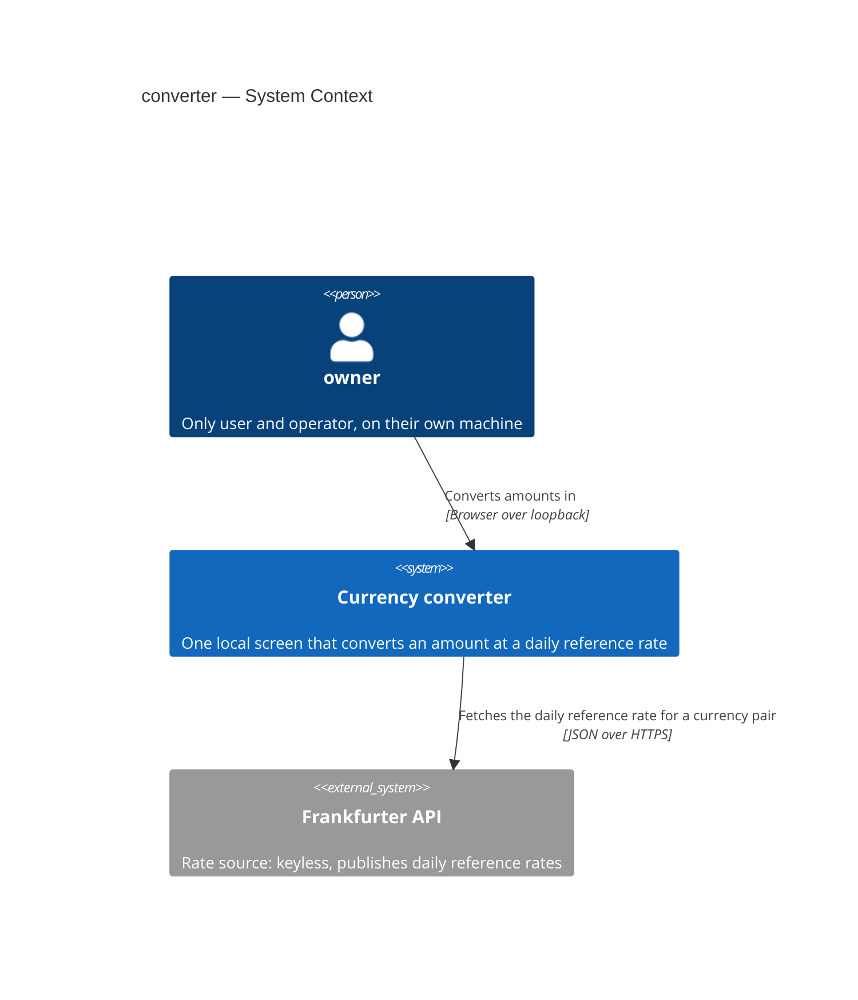
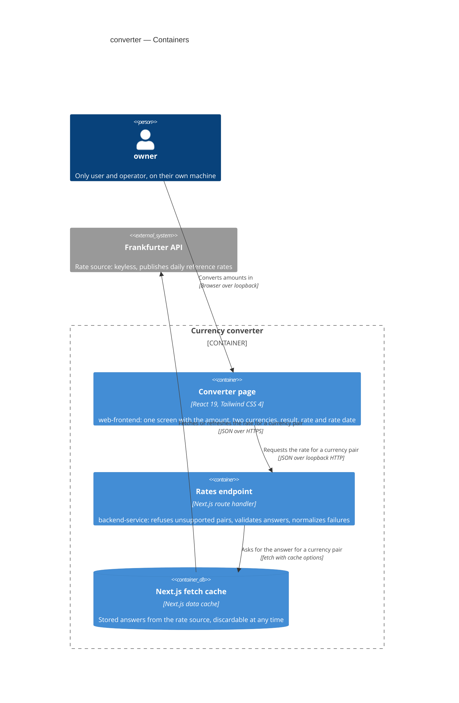
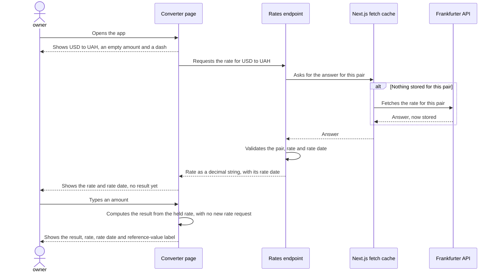
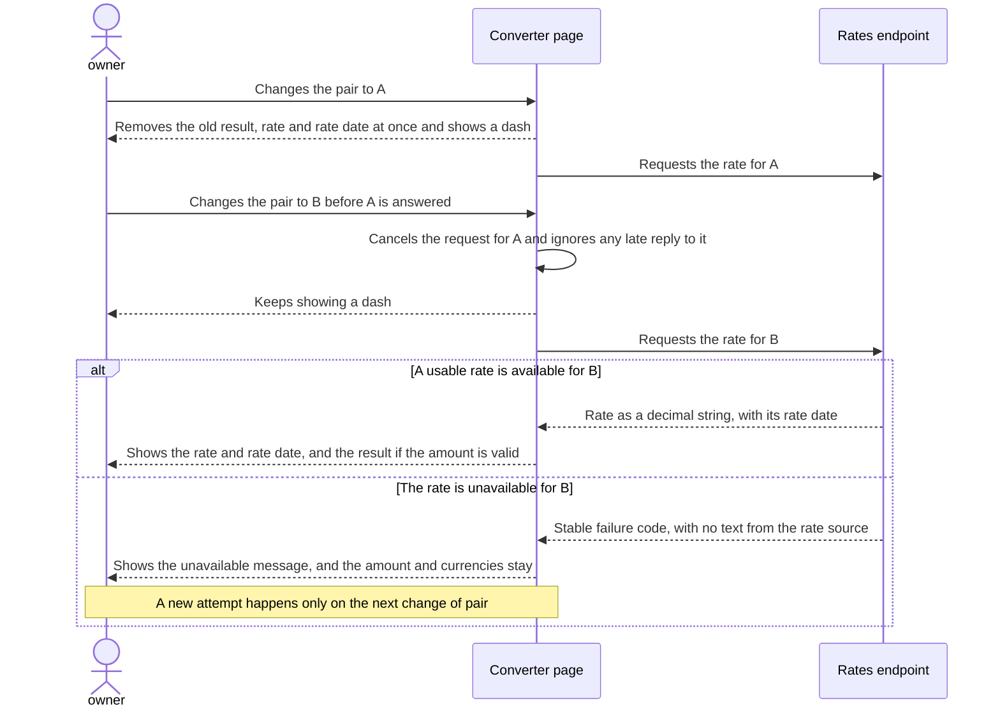
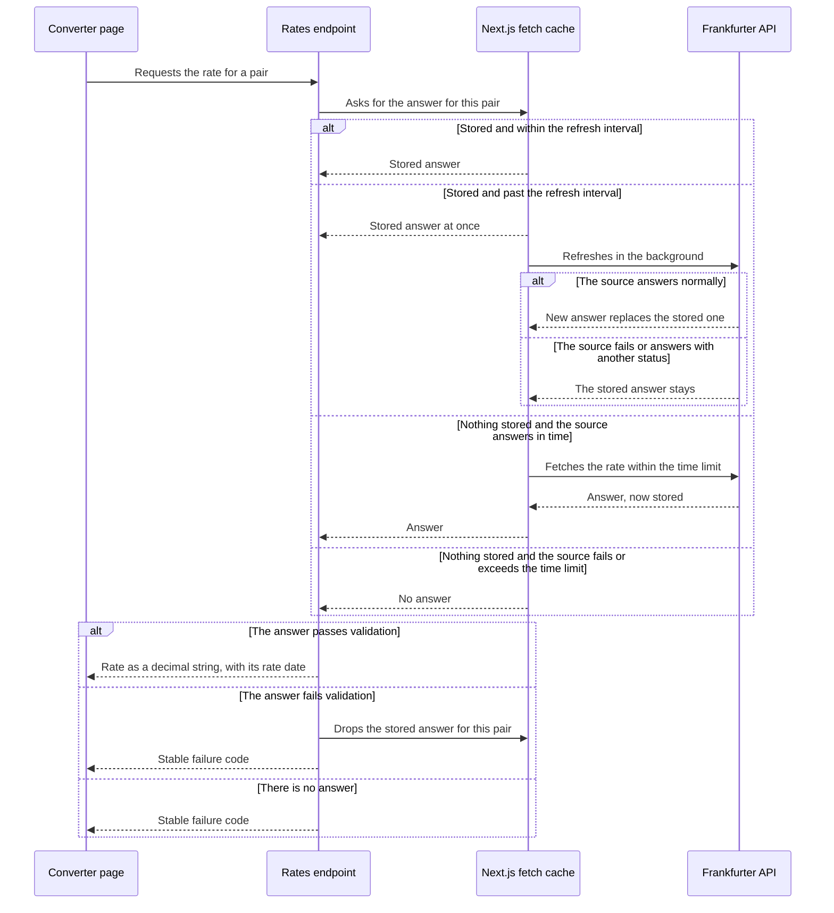

# Software Architecture Document — converter

## 1. Introduction and goals

**Intent.** One local screen where the owner types an amount, chooses two supported currencies and sees the reference result update as they type, always beside its daily reference rate, rate date and a reference-value label. The owner builds it to practise external integration, exact money calculation and interface work (spec §1), so "well implemented" has to be checkable.

**Top-3 quality goals (1-liners; full scenarios in §10):**

1. **Numeric correctness:** every reference result is exact decimal arithmetic with one rounding rule, checked against worked examples.
2. **Never misleading:** a number appears only with the currency pair, daily reference rate and rate date it belongs to, including during failures and out-of-order replies.
3. **Checkable finish line:** "well implemented" means 5 of 5 quality gates and full branch coverage of the money logic.

These goals break ties in later sections. Latency, throughput and availability are not goals here. Spec §6 sets no target for them: the owner declined a numeric response-time target, and a local app with one user gives these rows nothing meaningful to measure.

**Stakeholders.**

| Role | Interest | Sign-off owner? |
|---|---|---|
| owner | Only user and operator of the app; judges whether the feature is finished (AC-16) | Yes |

## 2. Constraints

**Technical.**
- TypeScript `~6.0` in `strict` mode on Node 22. The pin stays until `eslint-config-next`'s dependencies support newer majors (`docs/architecture-map.md`, Constraints).
- Next.js 16.4 (App Router), React 19, Tailwind CSS 4.
- `big.js` 7 for decimal arithmetic, `zod` 4 for validating network input.
- Vitest 5, Testing Library with jsdom, `msw` 3; ESLint 9 (pinned) and Prettier.
- No datastore. The only server-side state is the Next.js `fetch` cache (repo ADR-0003).
- `app`, `domain`, `server` and `ui` modules with dependencies pointing inward (repo ADR-0002).

**Organisational.**
- One owner, who is also the only reviewer.
- No deadline and no effort budget (spec §1).

**Conventions.**
- `CLAUDE.md` applies as written: money as `big.js` values inside `domain`, `zod` at the `server` boundary, the `{ "error": { "code", "message" } }` envelope, the browser reaching the server only through `/api/rates`, tests next to their source, the rate source faked with `server.use(...)`, and Tailwind utility classes only.
- CI today runs build, test, lint and typecheck with no coverage. This feature adds `npm run format:check`, the `@vitest/coverage-v8` dev dependency and a 100% branch threshold on `src/domain/`, as spec §6 requires.

**Regulatory / external.**
- No compliance regime applies: the data is public and no personal data is handled (spec §6.1).
- The rate source states no daily or monthly caps, but abuse limiting applies and its threshold is unstated (`docs/idea-brief.md` §6).

## 3. Context and scope

The owner runs the app on their own machine and uses it in a browser to convert amounts at a daily reference rate. There is no external trigger or other user. The app's server side fetches rates from one external rate source and passes them on, so the browser never talks to that source directly.

<!-- brownfield: scaffolded skeleton, checked directly at f3d81ba. src/app holds a placeholder page and test; src/domain, src/server and src/ui are empty; the msw harness fails unhandled requests. docs/architecture-map.md reflects 0515677 and still describes the target, but matches the tree. -->

**External systems (in / out):**

| Actor or system | Type | Interaction |
|---|---|---|
| owner | Person | Uses the screen in a browser on the same machine, with no sign-in or key |
| rate source (Frankfurter API) | System (external) | Publishes daily reference rates; receives only a currency pair, never the amount |

**Trust boundary.** Everything arriving from the rate source is untrusted until validated at the `server` boundary (AC-12). The app's own process and the owner's browser sit on one machine, reachable only over its loopback interface (the network path that stays inside the machine). Another device on the same network must not be able to reach the app at all (AC-15), so it has no interaction with the system and is not drawn below.

**C4 Context (L1):**



## 4. Solution strategy

**Top strategic choices (the seeds for ADRs):**

1. **Two surfaces in one process: `backend-service` and `web-frontend`.** The rates endpoint and the screen have different contracts and different tests, so they are declared separately, yet they run as one Next.js process with no second service to operate (repo ADR-0001). See [ADR-0001](./adr/0001-two-surfaces-in-one-nextjs-process.md).
2. **A static page whose rate arrives in the browser.** `src/app/page.tsx` stays a server component prerendered at build time and renders one client component from `src/ui/`, which requests the rate through `/api/rates` when the app opens and after every change of pair. A rate therefore has one path to the screen: `server` normalizes every failure and `ui` shows it as one state, which serves "never misleading", and the build never touches the network. State is plain React state with no store and no routing, because there is one screen. See [ADR-0002](./adr/0002-static-page-with-client-rate-fetching.md).
3. **Frankfurter v2 as the only rate source, one request per currency pair.** Each answer holds exactly one rate with its own date, which makes "this belongs to my pair" (AC-12) a simple check and gives the rate date AC-06 needs. This closes the spec §8 question on confirming the rate source. See [ADR-0003](./adr/0003-frankfurter-v2-one-request-per-pair.md).
4. **One-hour reuse in the `fetch` cache, dropping untrusted answers.** Each pair's answer is cached with a 3600-second refresh interval, within the spec §6 limit of 24 hours. A failed refresh keeps the stored rate, as AC-12 requires. An answer that fails validation is dropped at once, because the cache stores any answer with status 200 and would otherwise block a real new attempt for up to an hour. See [ADR-0004](./adr/0004-one-hour-fetch-cache-dropping-untrusted-answers.md).
5. **Local-only access through loopback binding.** The documented run commands bind to `127.0.0.1`, so the operating system refuses other devices before the app sees them (AC-15). See [ADR-0005](./adr/0005-bind-run-commands-to-loopback.md).

Each tactical decision in later sections traces to one of these seeds.

## 5. Building block view

The feature fills the layered modules from repo ADR-0002 without adding one: `app` composes, `domain` holds pure money logic and shared types, `server` talks to the rate source, and `ui` holds the screen and its state. Dependencies point inward, so `ui` and `server` meet only through types in `domain` and through `/api/rates`. This keeps money logic testable with no mocks, and it keeps upstream text out of the browser's reach.

**Internal decomposition:**

```
src/
├── app/
│   ├── layout.tsx            document language set to Ukrainian
│   ├── page.tsx              static server component; renders the converter
│   └── api/rates/route.ts    checks the pair, calls server, answers data or the error envelope
├── domain/                   all covered by the 100% branch target (spec §6)
│   ├── currency.ts           supported currencies, the currency pair, the swap rule
│   ├── amount.ts             typed text to empty, valid or rejected
│   ├── conversion.ts         exact calculation, half-up rounding, the "< 0,01" rule
│   ├── format.ts             result, rate and rate date as displayed
│   └── rate.ts               shared types: the rate answer and the failure codes
├── server/
│   └── rate-source.ts        request, time limit, cache options, zod validation, failure mapping
└── ui/
    ├── converter.tsx         client component: the fields, the swap control, the screen states
    ├── use-rate.ts           rate state tied to the selected pair
    ├── rates-api.ts          browser request to /api/rates, zod validation of the answer
    └── messages.ts           all Ukrainian text in one place
```

**C4 Container (L2):**



`domain` is a code module used inside both containers, not something that runs on its own, so it appears in the tree above and not in the diagram. The `fetch` cache is drawn because it holds state and decides when the rate source is called. It is the framework's discardable cache, not a datastore in the sense of repo ADR-0003. The route calls `fetch`, and Next.js adds the caching around that call, so the arrow from the cache to the rate source is a simplification: the request runs in the same process.

**Rate on the wire.** `/api/rates` carries the rate as a decimal string with its base currency, quote currency and rate date. `server` converts the source's number to that string once, and `domain` builds the `big.js` value and the displayed digits from it, so the browser never holds a rate as a `number`. See [ADR-0006](./adr/0006-carry-rates-as-decimal-strings.md).

**Rate state.** `useRate(pair)` keeps each rate together with the pair it belongs to. When that pair differs from the selected one, the screen shows a dash in the same render, so an old rate never appears for even one frame (AC-13). A change of pair cancels the earlier request with an `AbortController` and ignores any late reply to it, including a failure (AC-13b). Every change of pair starts a new request, including a change back (AC-12, AC-13c). The result is derived on each render from the typed amount and the held rate and is never stored, so typing causes no rate request (AC-02). This choice has one alternative of note, React `use()` with `Suspense`, which was rejected because AC-13c keeps the amount independent of the rate, and that makes the boundaries harder to place and to test.

## 6. Runtime view

These flows seed the runtime view. The `sequences` stage extends it to cover every acceptance criterion in spec §5.

**Critical flow 1: open the app and convert while typing** (AC-01, AC-02, AC-03, AC-05, AC-07, AC-13c)



**Critical flow 2: change the pair, with a late reply and a failure** (AC-09, AC-12, AC-13, AC-13b, AC-13c)



**Critical flow 3: reuse, refresh and drop a stored answer** (AC-12, spec §6, ADR-0004)



## 7. Deployment view

One Node process runs on the owner's machine, bound to `127.0.0.1` on port 3000 and started with `npm run dev`, or with `npm run build` and then `npm start`. There are no replicas, no worker and no public deployment (spec §3). The `fetch` cache lives under `.next/cache`, and deleting it loses nothing except stored rates (repo ADR-0003).

**Monitoring:**
- No metrics, alerts or tracing, because one person uses the app on their own machine and spec §6 sets no targets for them.
- The route writes one line to the server console for each failure it answers, naming its reason: timeout, source status or failed validation. Text from the rate source stays in this console and never reaches the browser.
- A background refresh runs inside Next.js, outside the route's code, so the route cannot log its failure. The screen is unaffected, because it keeps showing the stored rate with its true rate date.

**Scaling thresholds:**
- None apply: the design serves one user on one machine.
- While the source answers normally, the cache bounds the load on it: at most 20 stored pairs, each refreshed at most about once an hour, which is at most about 480 requests a day. While it fails, nothing new is stored, so each change of pair reaches it, at the pace of one person.

## 8. Crosscutting concepts

| Concept | Convention | Where defined |
|---|---|---|
| Error handling | The route answers failures as `{ "error": { "code", "message" } }`. `invalid_pair` has status 400 and `rate_unavailable` has status 502. The UI maps the code to its state and uses its own Ukrainian text, so `message` is fixed developer text and never upstream text | `CLAUDE.md`; [ADR-0007](./adr/0007-two-failure-codes-until-step-3.md) |
| Rate source validation | `zod` at the `server` boundary requires exactly one item with the requested base and quote, a positive rate and a real calendar date. Anything else is untrusted (AC-12), and rate date age alone never is | `CLAUDE.md`; here |
| Browser validation | `src/ui/rates-api.ts` parses the `/api/rates` answer with `zod`. Anything unexpected counts as the rate being unavailable | Here |
| Time limit | 5 seconds per request to the rate source, using `AbortSignal.timeout`. There is no separate browser limit, because the server's limit bounds the wait and a browser limit could fire during a slow first compile in development | Here |
| Money | `big.js` values inside `domain`, rounded to two decimal places with a half going up | `CLAUDE.md`; repo ADR-0002 |
| Number formatting | Written by hand from `big.js` output, without `Intl`: a decimal comma, and a non-breaking space (U+00A0) between thousands in results (AC-01). Rates have no grouping (AC-05). `Intl` takes its symbols from locale data that can change between runtimes | Here |
| Dates | The rate date stays a `YYYY-MM-DD` string and is shown as `DD.MM.YYYY` by rearranging its parts. It never becomes a `Date`, so no time zone can shift it (AC-06) | Here |
| Supported currencies | One list in `domain`. The route refuses other currencies and identical pairs without calling the rate source (spec §6.1) | Here |
| Browser cache | The route answers with `Cache-Control: no-store`, so returning to a pair really requests the rate again (AC-13c) | Here |
| Authentication | None. Access is limited by the loopback binding (AC-15) | [ADR-0005](./adr/0005-bind-run-commands-to-loopback.md) |
| Logging | One server console line per failure the route answers, naming its reason | §7 |
| Internationalisation | Ukrainian only, with all text in `src/ui/messages.ts` and the document language set to `uk`. Currency codes stay as UAH, USD, EUR, GBP and PLN (AC-14). There is no translation library | Here |
| Keyboard and form controls | Native `input`, `select` and `button` elements with visible labels and `focus-visible` styles (AC-14). The amount field is `type="text"` with `inputMode="decimal"`, so rejected text stays as typed (AC-10) | Here |
| Choosing a currency | A native `select` whose every `change` counts as a choice: it requests the rate and may swap the fields (AC-08). Moving through a closed list with the arrow keys therefore counts too, where the browser changes the value that way, and passing over the other field's currency swaps them. This closes the spec §8 question on arrow keys, keeping its default | Here |
| Styling | Tailwind CSS 4 utility classes with no custom design system, because visual polish is roadmap step 4 | `CLAUDE.md` |
| Tests | As in `CLAUDE.md`, with `next/cache` mocked in `server` and route tests, because `revalidateTag` needs the Next.js request context | `CLAUDE.md`; here |
| ID strategy | None, because the app has no entities | Repo ADR-0003 |
| Events | None, because all communication is synchronous and in one process or over `/api/rates` | Repo ADR-0002 |

## 9. Architecture decisions

| # | Title | Status | Section |
|---|---|---|---|
| 0001 | Declare backend-service and web-frontend as two surfaces of one Next.js process | Accepted | §4 |
| 0002 | Prerender a static page and fetch the rate from a client component | Accepted | §4 |
| 0003 | Use Frankfurter v2 as the only rate source, with one request per currency pair | Accepted | §4 |
| 0004 | Cache each pair's answer for one hour and drop answers that fail validation | Accepted | §4 |
| 0005 | Bind the documented run commands to the loopback address | Accepted | §4 |
| 0006 | Carry rates between server and browser as decimal strings | Accepted | §5 |
| 0007 | Answer failures with two codes until roadmap step 3 needs more | Accepted | §8 |

ADR files live under `docs/features/converter/adr/NNNN-<title>.md`. This numbering is separate from the repository's own decisions in `docs/adr/`, which this document cites as "repo ADR-NNNN".

## 10. Quality requirements

Goals QG-1 to QG-3 expand the top-3 from §1. QG-4 and QG-5 cover the remaining spec §6 row and the one access rule. Targets in quotation marks are verbatim from spec §6.

**QG-1. Numeric correctness**
- **When:** the worked examples from spec §5 run against the money logic, including 100 at 45,436 (4 543,60), 1,50 at 1,23 (1,85), 1,15 at 1,1 (1,27) and 0,10 at 0,022009 (`< 0,01`).
- **Then:** "100% of the worked examples in §5, calculated ahead of the code, match to the last decimal place".
- **How verify:** "Automated tests with no shared code between expected values and the calculation": literal expected values in `src/domain/*.test.ts`, with no mocks. The owner also compares one pair in both directions against the rate source (AC-16).

**QG-2. Never misleading**
- **When:** the pair changes, a reply arrives late, the rate source fails or exceeds the time limit, or an answer cannot be trusted.
- **Then:** the screen behaves as AC-12, AC-13, AC-13b and AC-13c state: no old number survives a change of pair, a late reply is ignored, no result appears without a usable rate, and no text from the rate source reaches the screen. Spec §6 sets no numeric target for this goal.
- **How verify:** component tests with `msw` (`src/ui/*.test.tsx`) cover replies out of order and all 9 cells of the AC-13c table. `server` and route tests cover each untrusted form in AC-12 and assert the fixed failure codes and messages.

**QG-3. Checkable finish line**
- **When:** continuous integration runs on the final change.
- **Then:** "5 of 5 pass: build, tests, lint, type check, format check", and "100% of branches in the money logic, meaning all code in `src/domain/`: amount parsing, calculation, rounding, the `< 0,01` rule and number formatting".
- **How verify:** "Continuous integration run on the final change", and "Coverage report in the same continuous integration run; coverage below the target fails the run", using a Vitest threshold scoped to `src/domain/`. The owner's manual checks in AC-16 complete the finish line.

**QG-4. Rate refresh on the server side**
- **When:** the rates request is made.
- **Then:** "A stored rate becomes due for refresh at most 24 hours after it was received"; a rate past the interval may still be shown, always with its true rate date.
- **How verify:** "Automated test that the rates request declares a refresh interval of at most 24 hours": a test reads the `next` option passed to `fetch`. "The actual reuse and refresh are left to the framework's cache and are not separately tested", so §11 adds one manual probe.

**QG-5. Local-only access**
- **When:** the app is started by a documented run command, and another device on the same network tries to open it.
- **Then:** the owner gets the screen with no sign-in or key, and the other device cannot reach the app at all (AC-15).
- **How verify:** a test reads `package.json` and asserts the loopback flag on both run scripts. The owner also fails to open the app from another device (AC-16).

## 11. Risks and technical debt

| Risk / debt | Severity | Mitigation | Owner |
|---|---|---|---|
| The rate source is down and nothing is stored for the pair, so no result appears | Medium | Accepted behaviour (AC-12). Stored rates survive an outage (ADR-0004), and the fallback question stays open below | Vlad |
| The rate source's answer shape is an observation, not a published guarantee, and its coverage check was one-time. A change makes every pair unavailable until the schema is updated | Medium | `zod` treats any change as untrusted, so the screen never shows a wrong number. Only `src/server/` needs changing (ADR-0003) | Vlad |
| Stored-rate behaviour rests on Next.js internals that were read in 16.4.3 but not run, including dropping an untrusted answer with `revalidateTag`. Spec §6 leaves them untested | Medium | One manual probe during `implement`: run the production build against a temporary local stand-in for the rate source, then confirm a stored answer is reused and an untrusted one is dropped. Repeat it after a Next.js major upgrade | Vlad |
| An untrusted answer arriving during a background refresh replaces a good stored rate, and dropping it leaves the pair with nothing stored | Low | Accepted as rare. The next change of pair asks the rate source again (ADR-0004) | Vlad |
| The source's abuse limit is unstated | Low | The cache bounds normal load (§7), and one person sets the pace during failures | Vlad |
| Starting the framework directly, such as `npx next dev` without the flag, listens on all interfaces | Low | AC-15 covers documented commands only, and `CLAUDE.md` documents the scripts (ADR-0005) | Vlad |
| In development, a request with `Cache-Control: no-cache`, such as with the browser tools' "Disable cache" on, bypasses stored answers | Low | Check AC-12 stored-rate behaviour on the production build or with that option off | Vlad |
| A rate is exact only up to 15 significant digits, because the source sends a JSON number. Rates seen on 2026-10-31 have 5 or 6 | Low | Reading the raw JSON text would remove the limit, and it touches only `src/server/` (ADR-0006) | Vlad |
| If the local server hangs, the dash stays indefinitely, because the browser has no limit of its own | Low | Reloading the page starts over (AC-12). Roadmap step 3 covers slow states | Vlad |
| Moving through a closed list with the arrow keys can swap the fields when it passes the other field's currency, and the key behaviour varies by browser and system | Low | Accepted as the spec default (§8). The owner sees it during the keyboard walk (AC-16) | Vlad |
| `docs/architecture-map.md` reflects commit `0515677`, still describes the target rather than the built skeleton, and calls Frankfurter a proposal | Low | Checked by hand for this design and consistent with the tree. Run `/sdd:survey` after this feature is built | Vlad |
| Open architectural decision: may the screen fall back to the last rate the browser received when nothing is stored (roadmap D3)? | Open question | Resolve when roadmap step 3 is specified; the default stays no result (AC-12) | Vlad |

Spec §8 lists three questions. The rate source question is closed by ADR-0003 and the arrow key question by §8, both keeping the spec's default. The third is the open row above.

**Accepted debt (acceptable in v1, plan to fix later):**
- The dependency rule between modules is a convention with no lint rule (repo ADR-0002), and nothing yet stops a client component importing `server`. Review checks it.
- One unavailable message and one failure code cover every kind of rate failure until roadmap step 3 (ADR-0007).
- `CLAUDE.md` and the architecture map need small updates once this ships: the run commands bind to loopback, and CI also runs the format check and coverage.

## 12. Glossary

Domain terms come from `CONTEXT.md`, which stays canonical. The last four terms are technical terms this document adds.

| Term | Meaning |
|---|---|
| currency pair | An ordered source currency and target currency. USD to UAH and UAH to USD are two pairs, each with its own published rate |
| daily reference rate | The rate the rate source publishes for one currency pair, updated about once a day. Not the rate a bank or exchange actually offers |
| owner | The one person who runs and uses the app on their own machine. Not a user account: the app has no accounts |
| rate date | The date the rate source states for one specific daily reference rate. Not today's date or the date of the request |
| rate source | The external service that publishes daily reference rates. Not the app's own server side, which only passes rates on |
| reference result | An amount multiplied by a daily reference rate and rounded to two decimal places. Not the amount a bank or exchange would pay out |
| supported currency | One of UAH, USD, EUR, GBP and PLN. Not every currency the rate source publishes |
| stored answer | A rate source answer held in the Next.js `fetch` cache. It stays usable past the refresh interval (spec §6) |
| refresh interval | How long a stored answer is reused before it is refreshed in the background: one hour here (ADR-0004) |
| untrusted answer | An answer from the rate source that fails validation: an unexpected form, a missing, zero or negative rate, another pair, or a missing or invalid rate date (AC-12) |
| loopback | The network path that stays inside one machine, reached at `127.0.0.1` |
