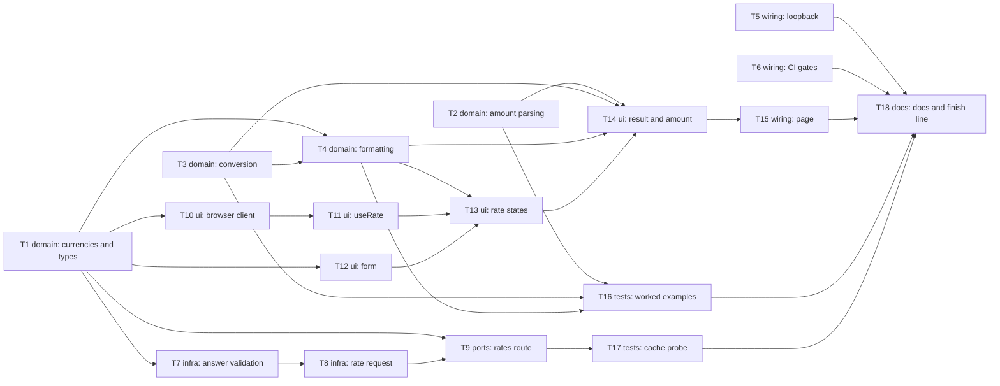

# Epic — converter

> **Spec:** [spec.md](../spec.md) · **Design:** [sad.md](../sad.md) · **Data model:** [data-model.md](../data-model.md) · **API:** [openapi.yaml](../contracts/openapi.yaml) · **ADRs:** [adr/](../adr/)

## Goal

The owner converts an amount between any two supported currencies on one local screen, with no convert button. Every number is computed exactly and appears with the rate, rate date and currencies it belongs to. "Well implemented" becomes checkable through keyboard operation, quality gates and independently verified numbers (spec §2).

## Scope

- **In:** `src/domain/` money logic, `src/server/` rate source client, the `/api/rates` route, `src/ui/` screen and rate state, the page, loopback run commands, CI gates and coverage.
- **Out:** distinct loading states, kinds of failure, retries and last-known rates (roadmap step 3); visual polish and a design system (roadmap step 4); real-time rates, accounts, charts, history and public deployment; currencies beyond the five (spec §3).

## Task map

- **Wave 1:** T1, T2, T3, T5, T6
- **Wave 2:** T4, T7, T10, T12
- **Wave 3:** T8, T11, T16
- **Wave 4:** T9, T13
- **Wave 5:** T14, T17
- **Wave 6:** T15
- **Wave 7:** T18

Tasks in one wave can run in parallel, except where they share a file: T5, T6 and T12 share `package.json`; T7 and T8 share `src/server/rate-source.ts`; T12, T13 and T14 share `src/ui/converter.tsx`.

## Tasks

See [tracker.md](./tracker.md) for status. Machine contract: [tasks.json](../tasks.json).

| # | Task | Layer | Blocked by | DoD (short) |
|---|---|---|---|---|
| T1 | Define supported currencies, the currency pair, the choice rule and shared rate types | domain | — | Unit tests in src/domain/currency.test.ts and src/domain/rate.test.ts pass for AC-07's list and default pair and AC-08's swap rule, with 100% branch coverage of both files. |
| T2 | Parse typed amount text into empty, valid or rejected | domain | — | src/domain/amount.test.ts passes for every example in AC-10 and AC-11, with 100% branch coverage of amount.ts. |
| T3 | Compute the reference result with exact arithmetic, half-up rounding and the below-minimum rule | domain | — | src/domain/conversion.test.ts passes for the AC-03 and AC-04 examples with literal expected values and 100% branch coverage of conversion.ts. |
| T4 | Format the result, rate and rate date as displayed | domain | T1, T3 | src/domain/format.test.ts passes for the literal strings in AC-01, AC-04, AC-05 and AC-06, with 100% branch coverage of format.ts. |
| T5 | Bind the documented run commands to the loopback address | wiring | — | src/app/run-scripts.test.ts passes, and after npm start the port 3000 listener is bound to 127.0.0.1 only. |
| T6 | Add the format check and a 100% branch threshold on src/domain to CI | wiring | — | npm run test:coverage fails on a temporary untested branch in src/domain and passes without it, and ci.yml runs build, test:coverage, lint, typecheck and format:check. |
| T7 | Validate the rate source's answer into a rate, rejecting every untrusted form | infra | T1 | src/server/rate-source.test.ts passes for each untrusted form in AC-12 and for an old rate date passing through unchanged per AC-06. |
| T8 | Request the rate with the time limit and cache options, and drop untrusted answers | infra | T7 | src/server/rate-source.test.ts passes for the request URL, a declared refresh interval of at most 24 hours, the 5000 ms limit, each failure reason, and the drop on an untrusted answer. |
| T9 | Answer GET /api/rates with the rate or the error envelope | ports | T1, T8 | src/app/api/rates/route.test.ts passes for 200, every 400 and 502 branch with exact bodies and no-store, and npm run build reports the route as dynamic. |
| T10 | Request the rate from the browser and validate the reply | ui | T1 | src/ui/rates-api.test.ts passes for a valid reply and every unexpected reply in the edge table, each resolving as unavailable without rejecting. |
| T11 | Hold the rate state tied to the selected pair | ui | T10 | src/ui/use-rate.test.tsx passes for pending in the same render, out-of-order rate and failure replies, and A to B to A with a new request and no stale rate. |
| T12 | Build the converter form with its fields, swap control and Ukrainian text | ui | T1 | src/ui/converter.test.tsx passes for the opening state, both swap paths and a Tab walk through all four labelled controls, with all text in messages.ts. |
| T13 | Show the rate, rate date, dash and unavailable message on the screen | ui | T4, T11, T12 | src/ui/converter.test.tsx passes for the dash, ready and unavailable states with literal strings, the new-direction request on swap, and no retry on typing. |
| T14 | Derive and show the reference result, the label and the amount message | ui | T2, T3, T4, T13 | src/ui/converter.test.tsx passes for all nine AC-13c cells, the 4 543,60 UAH example with a non-breaking space, the below-minimum display, and one request while typing. |
| T15 | Render the converter from the static page and set the document language | wiring | T14 | src/app/page.test.tsx passes for the AC-07 opening state, and npm run build succeeds with no network and reports / as static. |
| T16 | Check the worked examples from typed text to displayed string | tests | T2, T3, T4 | src/domain/worked-examples.test.ts passes for the worked examples in AC-01, AC-03 and AC-04, with literal expected strings and no mocks. |
| T17 | Probe the stored-answer behaviour on the production build | tests | T9 | docs/features/converter/_audit/cache-probe.md records every scenario as matching on the production build, and git diff shows no leftover change in src/. |
| T18 | Update the project docs and write the owner's finish-line checklist | docs | T5, T6, T15, T16, T17 | CLAUDE.md and docs/architecture-map.md state the loopback run commands and the five CI gates, and _audit/finish-line.md lists the four manual checks and three security items unticked. |

## Risks / Hard rules

- **Money:** amounts and rates are `big.js` values inside `domain`, never `number` arithmetic. Rates are decimal strings on the wire (ADR-0006).
- **Trust boundary:** everything from the rate source is parsed with `zod` in `server`, and raw upstream text never reaches the browser (AC-12).
- **Never misleading:** a result appears only with a valid amount and a ready rate for the selected pair (AC-13, AC-13b, AC-13c).
- **Module direction:** `domain` imports nothing from the other modules, and client components never import `server`. This is a convention with no lint rule (`sad.md` §11), so review checks it.
- **Tests never call the real API:** unhandled requests fail the test.
- **Framework risk:** stored-answer behaviour was read in Next.js 16.4.3 but not run (`sad.md` §11). T17 runs it, and a mismatch stops for the owner's decision.
- **Outside `implement`:** the manual checks and security review in AC-16 are the owner's, during `review`. T18 prepares them.
