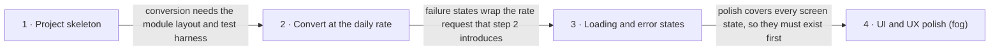

# Roadmap — currency-converter

> **A decomposition, not a promise.** The overall idea broken into incremental steps: what each
> step is, where it comes from, how big it is — or that nobody has looked at it yet — and in which
> order, and parallel lanes, we walk them. **No dates** (except shipped history), **no scores** —
> order is the prioritization. The *solution* for any step lives in its `docs/features/<slug>/`
> spec, not here.

## Destination

The owner runs a local one-screen browser app that converts an amount between two currencies with exact arithmetic at a dated daily reference rate, behaves clearly when rates are slow or unavailable, and meets the owner's own agreed criteria for UI, UX and readable code.

## Steps

| # | Step | Source | Size | Status |
|---|---|---|:---:|---|
| 1 | Project skeleton — the owner can build, boot, test and lint an empty app | `docs/architecture-map.md` §Module inventory | S | idea |
| 2 | Convert an amount at the daily rate — the owner enters an amount, picks two currencies, and sees the exact result with its rate date | `docs/idea-brief.md` §7. Recommendation | M | building |
| 3 | Clear loading and error states — the owner sees what is happening when rates are slow or cannot be loaded | `docs/idea-brief.md` §6. Risks | S | idea |
| 4 | UI and UX polish to the owner's bar → see [Not yet specified](#not-yet-specified) | `docs/idea-brief.md` §2. Problem | fog | idea |

## Not yet specified

| Area | What we'd have to learn | Blocks | How it gets sharpened |
|---|---|:---:|---|
| What "a well-built UI, a pleasant UX and clean code" means here | Which checkable criteria the owner accepts, and which of them the working screen already meets once it can be seen | 4 | A conversation with the owner while specifying step 2, then `/sdd:design-system` for tokens and components; the row then trades `fog` for a real size |

## Out of scope

- Separate backend — the keyless rate source makes one unnecessary; the Next.js route handler stays inside the one app.
- Public deployment — the owner is the only user, and deployment is not a learning goal.
- User accounts, rate charts and rate history — excluded to keep the first version to one screen.
- Real-time rates — the owner accepted daily rates, which need no key or paid provider.

## Open decisions

| # | Question | Type | Owner | Blocks |
|---|---|:---:|:---:|:---:|
| D1 | Which currencies must the app support? | grilling | human | 2 |
| D2 | Does Frankfurter v2 cover every currency chosen in D1, so it can be confirmed as the rate source? | research | agent | 2 |
| D3 | When rates cannot be loaded, does the screen only show an error, or also keep using the last rates it received? | grilling | human | 3 |

## Decisions so far

- Local browser app with one screen and daily reference rates → [`docs/idea-brief.md`](./idea-brief.md)
- Next.js full-stack TypeScript, with a route handler between the page and the rate source → [`docs/adr/0001-next-js-full-stack-typescript.md`](./adr/0001-next-js-full-stack-typescript.md)
- Layered `src/` modules with money logic isolated in `domain` → [`docs/adr/0002-layered-src-modules.md`](./adr/0002-layered-src-modules.md)
- No persistent datastore → [`docs/adr/0003-no-persistent-datastore.md`](./adr/0003-no-persistent-datastore.md)

## Dependency graph

## Execution path

| Wave | Steps | Zone per step (why parallel-safe) | Unlocks |
|:---:|---|---|---|
| 1 | 1 | 1: repo root and `src/` (new) | 2 |
| 2 | 2 | 2: `src/domain/`, `src/server/`, `src/ui/`, `src/app/` (new) | 3 |
| 3 | 3 | 3: `src/server/`, `src/ui/`, `src/app/api/rates/` (new) | 4, once its fog clears |

## Shipped

| Step | Shipped | Link |
|---|---|---|
